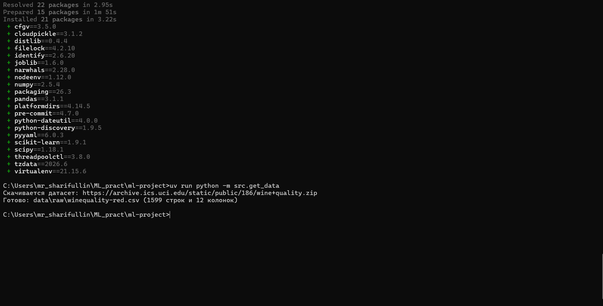
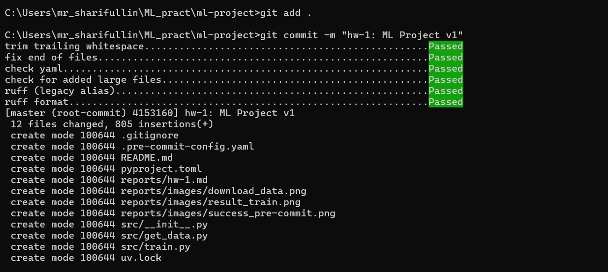
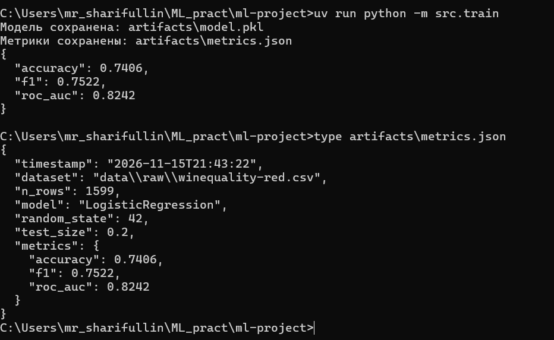

# Отчёт HW 1. Воспроизводимый ML-проект


## Что сделано

- `src.get_data` скачивает датасет Wine Quality и проверяет файл (1599 строк, 12 колонок)
- `src.train` обучает LogisticRegression и сохраняет в `artifacts/model.pkl`
  и `artifacts/metrics.json` (метрики + различные данные текущего запуска)
- Настроены Ruff и pre-commit (ruff-check, ruff-format,  хуки)
- ML-проект на uv: `pyproject.toml`и `uv.lock`, установка командой `uv sync`

## Результат обучения

Содержимое `artifacts/metrics.json` последнего запуска:

```json
{
  "timestamp": "2026-11-15T21:43:22",
  "dataset": "data\\raw\\winequality-red.csv",
  "n_rows": 1599,
  "model": "LogisticRegression",
  "random_state": 42,
  "test_size": 0.2,
  "metrics": {
    "accuracy": 0.7406,
    "f1": 0.7522,
    "roc_auc": 0.8242
  }
}
```

## Скриншоты

### 1. Загрузка данных


### 2. Успешный pre-commit


### 3. Обучение и артефакты

